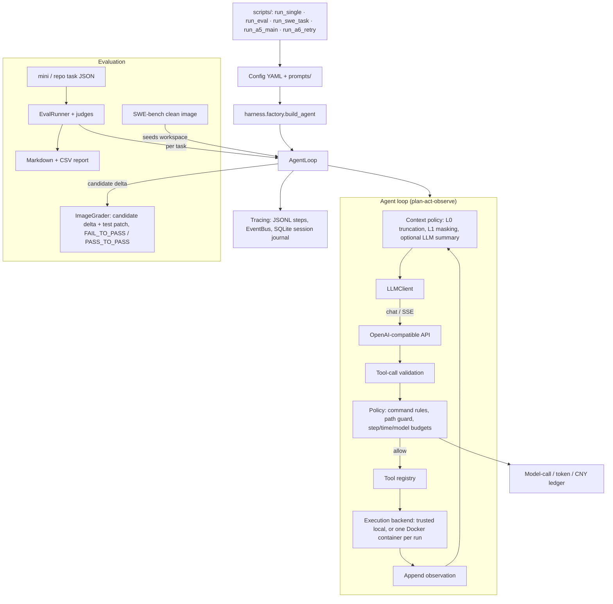

# Coding Harness

**中文文档**：[README.zh-CN.md](README.zh-CN.md) · [学习指南（阅读顺序与自测题）](docs/LEARNING.zh-CN.md)

A controllable Coding Agent Runtime with integrated Eval Harness — built for reproducible, measurable, regressable agent evaluation.

**A5-main:** on 56 SWE-bench Verified tasks, B0 (no memory, 68.5% solved) was compared with B2 (injected validated_fix cards mined by rule from earlier tasks in the same repository), 3 runs each; no effect larger than 13.1 percentage points was detected. See the [project history](docs/PROJECT-HISTORY.zh-CN.md), [A5-main design](docs/sprint/A5-MAIN-DESIGN.zh-CN.md), [run inventory](docs/sprint/A5-MAIN-INVENTORY.md), and in the agent repository the [results report](../agent/docs/sprint/A5-MAIN-RESULTS.zh-CN.md) and [final report](../agent/docs/A5-FINAL-REPORT.zh-CN.md).

Current controlled profile: [H3 Docker](docs/upgrade/H3-IMPLEMENTATION.zh-CN.md), [H4 context/plugin interface](docs/upgrade/H4-IMPLEMENTATION.zh-CN.md), and [real DeepSeek Flash integration](docs/upgrade/H5-DEEPSEEK.zh-CN.md). The [R1 closeout](docs/upgrade/R1-CLOSEOUT.zh-CN.md) records the verified scope and evidence. The DeepSeek demo uses a pinned public module slice and an independent grader; it requires Docker/Linux and explicit paid-call opt-in. Legacy host examples below are trusted-local only, not filesystem isolation.

After R1: [R2-lite true summary](docs/upgrade/R2-LITE-TRUE-SUMMARY.zh-CN.md) adds an explicit LLM summary provider with shared budgets and recovery deduplication; fixture remains the default. The [real-provider pilot](docs/upgrade/evidence/R2-real/README.md) completed one summary smoke, 36 fixed-history comparisons, and eight Docker repair runs. Summaries relieved some overflows, but factual adoption was inconsistent; improved repair success was not demonstrated.

A [wrapper-only follow-up and offline window preflight](docs/upgrade/evidence/R2-real/wrapper-01/README.md) reused nine fixed summaries: the historical-evidence wording achieved 26/27 fully correct answers versus 7/27 with the original wrapper. Runtime defaults remain unchanged; this mechanism result does not establish improved repair success.

## Architecture



## Quick Start

### 1. Install

```bash
pip install -e ".[dev]"
```

### 2. Configure

```bash
cp .env.example .env
# Edit .env with your API key and model
```

Or set environment variables directly (DeepSeek OpenAI 兼容，`base_url` 须含 `/v1`)：

```bash
export LLM_API_KEY="your-deepseek-api-key"
export LLM_BASE_URL=https://api.deepseek.com/v1
export LLM_MODEL=deepseek-v4-pro
```

PowerShell：

```powershell
$env:LLM_API_KEY = "your-deepseek-api-key"
$env:LLM_BASE_URL = "https://api.deepseek.com/v1"
$env:LLM_MODEL = "deepseek-v4-pro"
```

### 3. Run a Single Task

```bash
python scripts/run_single.py "Create a file hello.py that prints 'Hello, World!'"
```

With a specific config:

```bash
python scripts/run_single.py --config configs/hardened.yaml "List all files"

# Debug with lifecycle events:
python scripts/run_single.py --config configs/debug.yaml "List all files"
```

### 4. Run the Eval Suite

```bash
# Run with baseline config only
python scripts/run_eval.py --dataset datasets/mini_tasks.json --configs baseline

# Compare baseline vs hardened
python scripts/run_eval.py --dataset datasets/mini_tasks.json --compare
```

### 5. Run Tests

```bash
pytest tests/ -q
```

No API key is needed; tests use a mock LLM. In a clean clone on Windows, 654 pass and 25 are skipped (Linux-only or Docker-only). Four more fail because they read local evidence files that were never committed: the A5 memory records, the full Flask source archive, and two R2 seed files.

### 6. SWE-bench Runs (A5 / A6-R)

These need Docker, the SWE-bench interpreter envs (`scripts/setup_swebench_envs.py`), the clean baseline images, and a paid DeepSeek key. They also expect the agent repository checked out next to this one as `../coding-agent`: B2 loads the memory-card plugin from it, and run receipts record its git state.

```bash
# One task from configs/sprint/dev-tasks.yaml, zero model calls; still grades in Docker
python scripts/run_swe_task.py --task <instance_id> --mock

# A5-main: every pre-run check on the pool, no model calls
python scripts/run_a5_main.py --preflight

# A6-R: same, for the 22 tasks and 53 previous-attempt records
python scripts/run_a6_retry.py --preflight
```

Paid runs use the same scripts without `--mock` / `--preflight`. The frozen inputs and stop rules are in `docs/sprint/`.

## Configuration

Three reference configs are provided for the mini-task eval. The other files in `configs/` turn on single features (Docker backend, argv-only commands, plan-act, context compaction, read-only subagent, DeepSeek demo); `configs/sprint/b0-v2.yaml` is the profile used for A5 and A6-R.

| Config | Command Policy | Sandbox | Use Case |
|--------|---------------|---------|----------|
| `baseline.yaml` | allow_all (except dangerous patterns) | Path isolation + output truncation | Measure raw model capability |
| `hardened.yaml` | Strict whitelist | Path isolation + file size limits + output truncation | Measure safe-agent performance |
| `debug.yaml` | allow_all | Path isolation + lifecycle events | Local troubleshooting with `read_events` tool |

### Environment Variable Interpolation

Config files support `${VAR:default}` syntax:

```yaml
llm:
  api_key: "${LLM_API_KEY}"
  model: "${LLM_MODEL:deepseek-v4-pro}"
```

### System Prompt

The system prompt lives in `prompts/system_default.md`, configured via `runtime.system_prompt_path`. Edit the file to experiment with prompt behavior without touching Python code.

### Demo Trace

`docs/examples/demo_baseline_synthetic.jsonl` is a synthetic trace (Mock LLM, no API key needed) showing a full think→act→observe cycle: `read_file` → `write_file` → final answer.

## Dataset Format

Tasks are defined in JSON with a stable schema:

```json
{
  "id": "task_unique_id",
  "description": "Natural language task description",
  "initial_files": {
    "file.txt": "content",
    "subdir/": {}
  },
  "expected": {
    "type": "file_contains | command_output | keywords_in_answer | file_exists",
    "path": "relative/path",
    "keywords": ["must", "contain", "these"],
    "min_size_bytes": 10  // optional, for file_exists only
  },
  "difficulty": "easy | medium | hard",
  "tags": ["file-creation", "python"]
}
```

The `mini_tasks.json` dataset contains 36 tasks covering:
- File creation (Python, HTML, CSS, JSON, YAML, SQL, Markdown, CSV, etc.)
- File modification (typo fixes, variable renames, content updates)
- Multi-step operations (read-then-write, transform)
- Code generation (React components, TypeScript interfaces, Python modules)

## Interpreting the Report

The eval generates two files in `reports/`:

### Markdown Report (`report_*.md`)
- **Summary table**: per-config success rate, avg steps, avg time, tool failure rate
- **Comparison table**: delta between two configs (shown when running `--compare`)
- **Failure breakdown**: categorized by timeout / tool_error / policy_block / model_parse_error / step_limit
- **Per-task results**: each task with pass/fail, steps, timing

### CSV Report (`report_*.csv`)
- One row per task per config
- Columns: config, task_id, success, expected_check, steps, elapsed_ms, tokens, tool_failures, policy_blocks, failure_reason, trace_file

## Project Structure

```
coding-harness/
├── pyproject.toml                  # Dependencies & build (Python >= 3.11)
├── .env.example                    # Environment template
├── src/
│   ├── config/schema.py            # Pydantic validation of YAML configs
│   ├── harness/factory.py          # load_config + build_agent
│   ├── llm/                        # client.py (OpenAI-compatible), stream.py (SSE aggregation)
│   ├── runtime/                    # The agent loop
│   │   ├── loop.py                 # plan-act-observe cycle
│   │   ├── context.py, compact.py  # L0/L1 context policy, micro-compact of old tool output
│   │   ├── window.py, summary.py   # Model views over immutable history; optional LLM summary
│   │   ├── planner.py, state.py, hooks.py, retry.py
│   │   ├── deadline.py, awaitctl.py  # Monotonic deadline + cancellation
│   │   └── session.py, recovery.py   # Opt-in sessions; journal replay checks on resume
│   ├── tools/                      # read_file / write_file / list_dir, edit_file, search_replace,
│   │                               # search_code, run_command, read_events, subagent (read-only child),
│   │                               # container_files (file tools over Docker RPC), validation, registry
│   ├── policy/                     # sandbox (path guard), rules (command allow/block), limits, budget,
│   │                               # model_budget + cny_budget (shared ledgers),
│   │                               # plugin / registry / dispatcher / reposkill (H4-H5 plugin boundary)
│   ├── execution/                  # local (trusted), docker (one container per run),
│   │                               # baseline_image_backend + a5_image_backend (SWE-bench images), collector
│   ├── tracing/                    # JSONL step logger, EventBus, SQLite session journal, artifacts
│   └── eval/                       # EvalRunner, metrics, report, bootstrap CIs;
│                                   # image_grader (SWE-bench delta + test patch), grader + h3_runner (H3),
│                                   # repo_grader (whole-repo pytest), a5_* (A5 receipts, snapshots, pilot lock)
├── configs/
│   ├── baseline.yaml, hardened.yaml, debug.yaml   # Reference profiles for the mini-task eval
│   ├── docker.yaml, hardened_argv.yaml, plan_act*.yaml, context_compact*.yaml,
│   │   subagent_readonly.yaml, deepseek.yaml, ...  # Single-feature profiles
│   ├── sprint/                     # SWE-bench profiles (b0-v2.yaml = A5/A6-R) and task lists
│   └── a5/                         # A5 image handoff, price binding, preflight locks
├── prompts/                        # system_default.md, swe_b0.md (SWE-bench task prompt)
├── datasets/                       # mini_tasks.json (36), repo_tasks.json, swebench_lite_tasks.json
├── docker/                         # Test image for the Docker backend
├── scripts/                        # CLI entry points, see the table below
├── docs/
│   ├── PROJECT-HISTORY.zh-CN.md    # What was built, what failed, how it was fixed
│   ├── PROJECT-OVERVIEW.zh-CN.md, LEARNING.zh-CN.md, CONTAMINATION-NOTES.zh-CN.md
│   ├── INDEX.md                    # What each doc is, and the order to read them in
│   ├── sprint/                     # A5 / A6-R evidence chain: designs, preregistration, checkpoints (append-only)
│   ├── upgrade/                    # H3-H5 and R1-R2 implementation notes; evidence/ holds run records
│   ├── changes/                    # Two refactor closeout notes cited by the HP-01..04 evidence reports
│   └── examples/                   # Synthetic demo trace
├── reports/                        # Contamination probe, failure taxonomy, SWE-bench Lite validation log
└── tests/                          # 69 test modules, mock LLM, no API key needed
    └── fixtures/repos/             # 16 small repo tasks + 12 SWE-bench Lite source snapshots
```

Docs are grouped in [`docs/INDEX.md`](docs/INDEX.md): entry points, current implementation notes, the A5/A6-R evidence chain, and raw run records. `docs/sprint/PROGRESS.md` is an append-only work log, not a reading entry point.

### Scripts

| Group | Scripts |
|-------|---------|
| Mini-task eval | `run_single.py`, `run_eval.py`, `gen_failure_taxonomy.py`, `check_dataset_oracle.py` |
| SWE-bench setup | `setup_swebench_envs.py`, `swebench_specs.py`, `build_swebench_lite_subset.py`, `contamination_probe.py`, `build_clean_baseline.py`, `calibrate_clean_image.py`, `sprint2_calibrate.py`, `rewritten_sources.py` |
| SWE-bench runs | `run_swe_task.py` (single tasks, B0-B3), `regrade_saved_delta.py` |
| A5-main | `select_main_targets.py`, `sprint5_prepare_main.py`, `sprint5_rejudge_scan.py`, `run_a5_main.py`, `sprint6_*.py` (canary, statistics, regrade and diagnostic checks), `sprint7_inventory.py` |
| A6-R | `build_a6_attempts.py`, `run_a6_retry.py` |
| A5 preflight and pilot | `a5_preflight.py`, `preflight_a5_*.py`, `prepare_a5_typed_tree.py`, `recheck_a5_repo_baseline.py`, `audit_a5_*.py`, `calibrate_a5_image_grader.py`, `calibrate_pilot_image_grader.py`, `lock_a5_pilot_preflight.py`, `run_a5_pilot_fixture.py`, `run_a5_real.py`, `a5_django_observer.py`, `a5_pytest_observer.py`, `a5_memory_source_smoke.py`, `export_a5_memory_snapshot.py`, `sprint2_verify_memory.py`, `handoff_sha.py` |
| H3-H5 and R2 | `run_h3.py`, `run_grader.py`, `prepare_repo_grader.py`, `preflight_repo_grader.py`, `run_repo_grader.py`, `audit_repo_grader.py`, `run_deepseek.py`, `audit_deepseek.py`, `demo_h4.py`, `run_reposkill_interop.py`, `demo_true_summary.py`, `run_summary_pilot.py`, `run_summary_wrapper.py`, `audit_summary_pilot.py`, `check_summary_windows.py` |
| Audit | `audit/case_mem.py` (see `audit/README.md`) |

Every script has a docstring at the top that states whether it calls a model. One-off scripts from earlier sprints that nothing in `docs/sprint/` cites are kept out of this repository.

## Design Decisions

| Decision | Rationale |
|----------|-----------|
| Async throughout | Enables concurrent eval runs; `httpx` + `asyncio` are mature |
| Path guards + controlled Docker profile | Path guards reject file-tool traversal; arbitrary host commands require trusted-local use. Use `docker_linux` for the verified container boundary. |
| Config-driven tools | Same agent code, different safety profiles via YAML |
| JSONL tracing | Append-only, human-readable with `jq`, easy to query |
| `expected.type` in dataset | Four judge strategies (file_contains, command_output, keywords_in_answer, file_exists) cover most coding tasks without custom test harnesses |
| System prompt in file | Prompt text lives in `prompts/` directory, editable without touching Python — enables prompt experimentation |
| Intent-first journal, resume refuses unknown outcomes | A tool's intent is committed before it runs. On resume, committed results are reused; a non-idempotent operation whose outcome was never recorded blocks the run instead of being retried. See [SESSION-USAGE](docs/upgrade/SESSION-USAGE.zh-CN.md) and the four-window crash test in [R1-CLOSEOUT](docs/upgrade/R1-CLOSEOUT.zh-CN.md). |

## Dependencies

- `httpx` — async HTTP for LLM API calls
- `pyyaml` — config file parsing
- `pydantic` — config schema validation (catches YAML typos at startup)
- `jsonschema` — validates tool-call arguments against each tool's schema
- `pytest` + `pytest-asyncio` + `pytest-cov` — testing

Docker is optional for legacy trusted-local examples and required for the controlled `docker_linux` profile. No vendor SDKs — `LLMClient` wraps the OpenAI-compatible `/chat/completions` endpoint.
