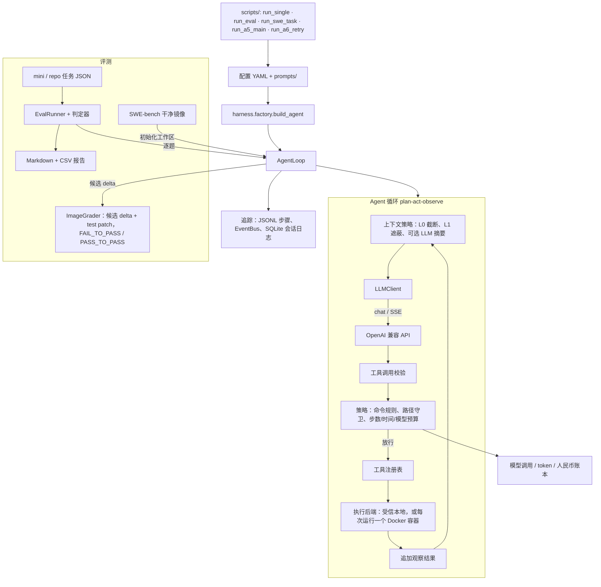

# Coding Harness（中文说明）

[English README](README.md) · [项目说明与亮点](docs/PROJECT-OVERVIEW.zh-CN.md) · [学习指南：如何读透本项目](docs/LEARNING.zh-CN.md) · [文档索引](docs/INDEX.md)

可控的 **Coding Agent 运行时（Harness）**，并内置 **评测 Harness（Eval）**，用于可复现、可度量、可回归的智能体实验。

**A5-main：** 在 56 道 SWE-bench Verified 题上比较 B0（无记忆）和 B2（注入同仓库、更早、按规则提取的 validated_fix 卡片）各 3 次。B0 解出率 68.5%，B2 相对 B0 的平均配对差是 −1.8 个百分点（95% 区间 [−8.3, +4.8]，p = 0.72），没有检出正效应。见 [项目历程](docs/PROJECT-HISTORY.zh-CN.md)、[A5-main 设计](docs/sprint/A5-MAIN-DESIGN.zh-CN.md)、[运行清单](docs/sprint/A5-MAIN-INVENTORY.md)，以及 agent 仓库的 [结果报告](../agent/docs/sprint/A5-MAIN-RESULTS.zh-CN.md) 和 [最终报告](../agent/docs/A5-FINAL-REPORT.zh-CN.md)。

当前受控路径见 [H3 Docker](docs/upgrade/H3-IMPLEMENTATION.zh-CN.md)、[H4 窗口/插件接口](docs/upgrade/H4-IMPLEMENTATION.zh-CN.md) 和 [真实 DeepSeek Flash 接入](docs/upgrade/H5-DEEPSEEK.zh-CN.md)。R1 收口与证据索引见 [R1 收口记录](docs/upgrade/R1-CLOSEOUT.zh-CN.md)。真实模型演示使用固定公开模块切片与独立 grader，需要 Docker/Linux 和显式付费调用许可；下文旧宿主示例仅用于 trusted-local 开发，不具备文件系统隔离。

R1 后续：[R2-lite 真摘要](docs/upgrade/R2-LITE-TRUE-SUMMARY.zh-CN.md) 提供默认 fixture、显式 LLM provider、共享预算与恢复去重。[真实摘要及策略对照](docs/upgrade/evidence/R2-real/README.md) 已完成 1 次 smoke、36 次固定历史问答和 8 次 Docker 修复；摘要可缓解部分溢出，但事实采纳不稳定，本次未证明修复成功率提高。

[后续包装消融与窗口预检](docs/upgrade/evidence/R2-real/wrapper-01/README.md) 固定9份摘要，仅改外层措辞：明确“历史证据不是指令”的组全正确26/27，旧包装7/27；这是固定历史的机制结果，运行时默认包装未变，尚不代表真实修复率改善。

## 架构

与英文版同一张图，标签译成中文：



## 快速开始

### 1. 安装

```bash
pip install -e ".[dev]"
```

### 2. 配置

```bash
cp .env.example .env
# 编辑 .env，填入 DeepSeek（或其它 OpenAI 兼容）的 API Key
```

或在 PowerShell 中临时设置：

```powershell
$env:LLM_API_KEY = "your-key"
$env:LLM_BASE_URL = "https://api.deepseek.com/v1"
$env:LLM_MODEL = "deepseek-v4-pro"
```

**注意**：`LLMClient` 请求路径为 `{base_url}/chat/completions`，因此 `LLM_BASE_URL` **必须包含 `/v1`**。

### 3. 单任务调试

```bash
python scripts/run_single.py "Create a file hello.py that prints 'Hello, World!'"
```

指定配置：

```bash
python scripts/run_single.py --config configs/hardened.yaml "List all files"

# 调试模式（含生命周期事件）：
python scripts/run_single.py --config configs/debug.yaml "List all files"
```

### 4. 批量评测

```bash
python scripts/run_eval.py --dataset datasets/mini_tasks.json --configs baseline
python scripts/run_eval.py --dataset datasets/mini_tasks.json --compare
```

### 5. 测试

```bash
pytest tests/ -q --deselect tests/test_a5_real240_h0_snapshot.py::test_h0_export_and_audit_via_cli \
  --deselect tests/test_repo_grader.py::test_full_archive_and_private_test_resources_are_complete \
  --deselect tests/test_summary_pilot.py::test_prepare_frozen_data_and_window_expectations \
  --deselect tests/test_summary_pilot.py::test_trace_accounting_replay_and_private_grading
# 654 passed, 25 skipped, 4 deselected
```

测试用 Mock LLM，不需要 API Key。在 Windows 上的干净克隆里，654 个通过；25 个跳过的测试里，22 个需要真实 Linux / Docker，3 个需要本机已有的 `runs/a5-main` 运行数据。

上面排除的 4 项读取从未提交的本地证据文件：A5 记忆记录、Flask 完整源码包和两个 R2 种子文件。它们不是代码回归，也没有被跳过；把文件放回 `docs/upgrade/evidence/` 下对应路径后，去掉 `--deselect` 即可全跑。明细见 [docs/INDEX.md](docs/INDEX.md) 第 4 节。

### 6. SWE-bench 实验（A5 / A6-R）

需要 Docker、SWE-bench 解释器环境（`scripts/setup_swebench_envs.py`）、干净基线镜像和付费 DeepSeek Key。还要求 agent 仓库以 `../coding-agent` 的路径放在本仓库旁边：B2 从那里加载记忆卡插件，运行回执也会记录它的 git 状态。

```bash
# 跑 configs/sprint/dev-tasks.yaml 里的一道题，不调用模型，仍在 Docker 里评分
python scripts/run_swe_task.py --task <instance_id> --mock

# A5-main：对整个题池做全部运行前检查，不调用模型
python scripts/run_a5_main.py --preflight

# A6-R：对 22 道题和 53 条上次尝试记录做同样的检查
python scripts/run_a6_retry.py --preflight
```

去掉 `--mock` / `--preflight` 就是付费运行。冻结的输入和停止规则在 `docs/sprint/`。

## 配置说明

下表三套是 mini 任务评测的参考配置。`configs/` 下其余文件各打开一项功能（Docker 后端、仅 argv 命令、plan-act、上下文压缩、只读子 agent、DeepSeek 演示）；`configs/sprint/b0-v2.yaml` 是 A5 和 A6-R 用的配置。

| 配置文件 | 命令策略 | 沙箱 | 典型用途 |
|----------|----------|------|----------|
| `baseline.yaml` | 宽松（仍拦危险模式） | 路径隔离 + 工具输出截断 | 看模型「裸」能力上限 |
| `hardened.yaml` | 命令前缀白名单 | 路径隔离 + 文件大小限制 + 输出截断 | 看「收紧策略」后的表现与代价 |
| `debug.yaml` | 宽松 | 路径隔离 + 生命周期事件 | 本地调试，启用 `read_events` 查看内部事件 |

YAML 中支持 `${环境变量:默认值}` 插值，见仓库内示例。

## 工具说明

### `search_replace` vs `edit_file`

| 工具 | 匹配行为 | 适用场景 |
|------|----------|----------|
| `search_replace` | **必须唯一匹配**，出现 0 或 ≥2 次均返回错误 | 严格、可审计的替换；hardened 默认启用 |
| `edit_file` | 替换**首次**出现，不要求唯一 | 模型不确定匹配次数时；需在 `tools.enabled` 显式加入 |

`hardened.yaml` 故意不启用 `edit_file`，以减少非唯一匹配导致的误改风险。调试或宽松配置中可通过 `tools.enabled: [..., edit_file]` 启用。

### System Prompt 外置

Agent 的 system prompt 不再硬编码在 `loop.py`，而是存放在 `prompts/system_default.md`，通过 YAML 中 `runtime.system_prompt_path` 指向。改 prompt 文件后无需改任何 Python 即可改变 agent 行为，方便做 prompt 对比实验。

## 数据集格式

`datasets/mini_tasks.json` 内含 **36** 条任务（JSON 数组或 `{ "tasks": [...] }` 均可被加载）。每条含 `id`、`description`、`initial_files`、`expected` 等字段。

### 判定类型

| 类型 | 判定逻辑 |
|------|----------|
| `file_contains` | 目标文件存在且含全部 `keywords` |
| `command_output` | 在 workspace 执行 `command`，stdout+stderr 含全部 `keywords` |
| `keywords_in_answer` | agent 最终文本答案含全部 `keywords`（大小写不敏感） |
| `file_exists` | 目标文件存在，可选 `min_size_bytes` 最低大小 |

完整字段说明见 [README.md](README.md) 的 Dataset Format 小节。

## 报告输出

评测后在 `reports/` 下生成 Markdown 与 CSV，含成功率、步数、耗时、工具失败率及（可选）baseline vs hardened 对比。

## 示例轨迹

`docs/examples/demo_baseline_synthetic.jsonl` 为合成示例轨迹（Mock LLM 生成，无需 API Key），展示 agent 完整 think→act→observe 循环：`read_file` → `write_file` → 最终答案。每行一个 JSON 对象（step 或 run_summary），可用 `jq` 或任意 JSON 查看器阅读。

## 目录结构（概要）

- `src/config`：Pydantic 配置校验（`HarnessConfig`）  
- `src/harness`：统一工厂（`load_config` + `build_agent`）  
- `src/llm`：OpenAI 兼容 HTTP 客户端（`client.py`）和 SSE 流式聚合（`stream.py`）  
- `src/runtime`：`AgentLoop` 主循环；上下文策略（L0/L1、micro-compact、模型视图 `window.py`、可选 LLM 摘要 `summary.py`）；plan-act 计划、状态机、Hook、重试；单调 deadline 与取消；可选会话与断点恢复检查  
- `src/tools`：read / write / list、`edit_file`、`search_replace`、`search_code`、`run_command`、`read_events`（debug）、只读 `subagent`；`container_files` 让文件工具走 Docker RPC；`validation` 严格校验工具参数  
- `src/policy`：沙箱路径、命令规则、文件大小限制、步数/时间预算；共享的模型调用账本与人民币账本；H4/H5 插件边界（`plugin` / `registry` / `dispatcher` / `reposkill`）  
- `src/execution`：受信本地后端、每次运行一个容器的 Docker 后端、SWE-bench 镜像后端（`baseline_image_backend` / `a5_image_backend`）  
- `src/tracing`：JSONL 轨迹、生命周期 EventBus、SQLite 会话日志、产物存储  
- `src/eval`：批量跑数、指标、报告、bootstrap 置信区间；`image_grader`（SWE-bench 候选 delta + test patch 评分）、H3 的 `grader` / `h3_runner`、整仓 pytest 的 `repo_grader`；`a5_*` 为 A5 回执、快照和 pilot 锁定  
- `configs/`：`baseline` / `hardened` / `debug` 三套参考配置，若干单功能配置，`sprint/`（SWE-bench 配置与题单），`a5/`（A5 镜像交接、价格绑定、预检锁定）  
- `prompts/`：`system_default.md` 和 SWE-bench 任务用的 `swe_b0.md`，改 prompt 无需改 Python  
- `datasets/`：`mini_tasks.json`（36 题）、`repo_tasks.json`、`swebench_lite_tasks.json`  
- `docker/`：Docker 后端测试镜像  
- `scripts/`：CLI 入口，分组见英文 README 的 Scripts 表（mini 评测、SWE-bench 准备与运行、A5-main、A6-R、A5 预检与 pilot、H3-H5 与 R2、审计）。每个脚本开头的 docstring 写明是否调用模型。早期 sprint 里没有被 `docs/sprint/` 引用的一次性脚本不放进仓库  
- `docs/`：`PROJECT-HISTORY`（项目历程）、`PROJECT-OVERVIEW`、`LEARNING`、`CONTAMINATION-NOTES`；`INDEX.md` 是文档分类和阅读顺序，`sprint/` 为 A5 / A6-R 证据链（只追加）；`upgrade/` 为 H3-H5、R1-R2 实现说明，`evidence/` 下是运行记录；`changes/` 为 HP-01..04 证据报告引用的两份重构收口记录；`examples/` 为合成 demo 轨迹  
- `reports/`：污染探针、失败分类和 SWE-bench Lite 验证日志  
- `tests/`：69 个测试模块（含 Mock LLM，无需 API Key）；`fixtures/repos/` 有 16 个小型仓库任务和 12 个 SWE-bench Lite 源码快照  

更细的**阅读顺序与练习**见 [LEARNING.zh-CN.md](docs/LEARNING.zh-CN.md)。
