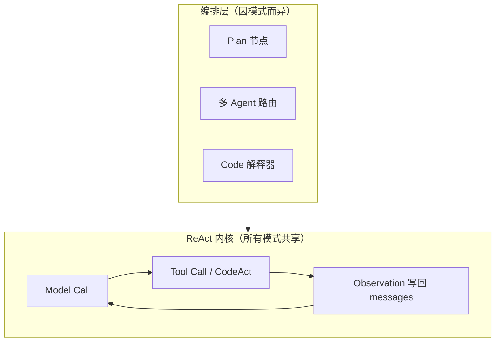
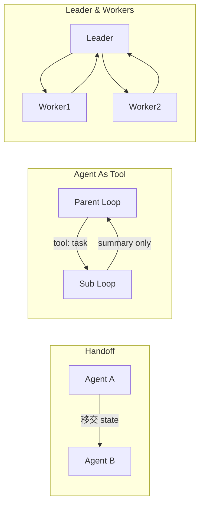
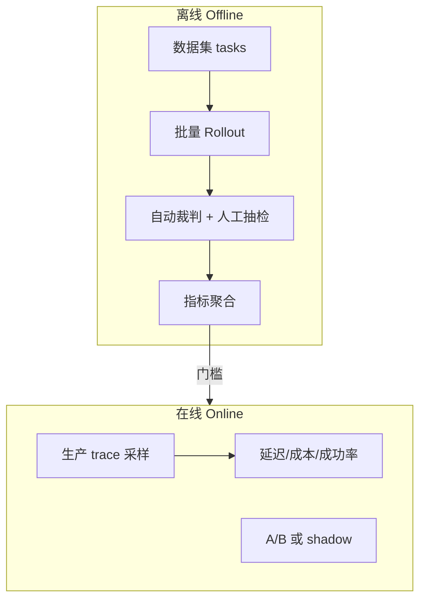

# Agent 工程面试八股文（详细版）

> **用途**：实习 / 校招 Agent、LLM 应用岗的系统化复习材料。  
> **结构**：对应业界常见的四条主线——(1) Agent Loop、(2) Skill 范式、(3) Agent Framework、(4) 评测与指标。  
> **说明**：本文偏「能讲、能画、能对比」；具体 API 以各框架文档为准。可与 `coding-harness`、`learn-claude-code-main` 对照阅读。

---

## 目录

1. [Agent Loop 模式](#1-agent-loop-模式)
2. [Skill 范式](#2-skill-范式)
3. [Agent Framework 底层设计](#3-agent-framework-底层设计)
4. [评测与指标](#4-评测与指标)
5. [面试速查表](#5-面试速查表)
6. [与 coding-harness 的对照索引](#6-与-coding-harness-的对照索引)

---

## 1. Agent Loop 模式

### 1.1 本质：一切协作模式都落在 ReAct Loop 上

**ReAct**（Reasoning + Acting）的核心不是某个开源库的名字，而是一种**控制流**：

```text
用户输入 → [Model Call] → 若需行动则 [Tool Call(s)] → 观察结果写回上下文 → 重复，直到停止
```

业界常说的 **PlanAct**、**MultiAgent**、**CodeAct**，区别不在于「是不是另一种魔法」，而在于：


| 模式             | 在 ReAct 之上多了什么              | 典型场景             |
| -------------- | --------------------------- | ---------------- |
| **ReAct**      | 单循环，模型每轮自行决定工具或结束           | 通用问答、简单工具调用      |
| **PlanAct**    | 显式「先规划再执行」阶段（计划可修订）         | 多步骤任务、需要可解释计划    |
| **CodeAct**    | 动作为可执行代码（脚本/函数），而非离散工具名     | 数据分析、复杂变换、强可控流水线 |
| **MultiAgent** | 多个 Loop 实例 + 协作协议（消息/委派/合并） | 探索与执行分离、专家分工     |


**面试一句话**：PlanAct / MultiAgent / CodeAct 都是 **ReAct Loop 的编排方式（Orchestration）**，不是替代 ReAct 的新范式。




---

### 1.2 各模式的理解与优缺点

#### 1.2.1 纯 ReAct（单 Agent 单循环）

**做法**：维护 `messages[]`，循环调用 LLM；若 `stop_reason` / `tool_calls` 表示需要工具，则执行并把结果 append 回对话。

**优点**

- 实现简单、调试路径短
- 与 OpenAI / Anthropic / 各类兼容 API 天然对齐
- 适合 Harness 注入策略（沙箱、预算、审计）

**缺点**

- 长任务上下文膨胀快
- 计划隐式存在于对话里，难以单独审计或回放「计划版本」
- 多领域知识全塞 system prompt 成本高

**coding-harness 对应**：`src/runtime/loop.py` 的 `AgentLoop.run()` 即标准实现。

---

#### 1.2.2 PlanAct（Plan → Act → 可能 Re-Plan）

**做法**：在循环外或循环内增加 **Plan 阶段**——先产出结构化子任务列表 / DAG，再逐步执行；执行失败或新信息出现时 **Re-Plan**。

常见实现形态：

1. **双阶段 prompt**：第一轮只要 JSON 计划，第二轮起按计划调工具
2. **LangGraph 节点**：`planner` → `executor` → `critic` → 条件边回 `planner`
3. **隐式 Plan**：模型在 assistant 消息里写「我将分三步…」，本质仍是单循环，但可读性差

**优点**

- 任务分解可见，利于 HITL 在计划层介入  
- 便于评测「计划是否合理」与「执行是否 follow plan」  
- 降低单轮 prompt 的决策负担

**缺点**

- 计划与真实环境可能脱节（幻觉计划）  
- Re-Plan 频繁会导致延迟与成本上升  
- 计划格式若不稳定，下游解析脆弱

**面试对比 ReAct**：ReAct 是 **边想边做**；PlanAct 是 **先想清单再做，允许改清单**。

---

#### 1.2.3 CodeAct

**做法**：模型输出 **代码**（Python/Bash/DSL），由 **沙箱解释器** 执行，stdout/stderr 作为 observation。

与「命名工具」的对比：


| 维度   | 命名工具（read_file, run_command） | CodeAct       |
| ---- | ---------------------------- | ------------- |
| 表达能力 | 受工具 schema 限制                | 可组合逻辑、循环、条件   |
| 可控性  | 易做白名单、审计                     | 需强沙箱，风险更高     |
| 可观测性 | 每步工具名清晰                      | 需记录代码片段与执行结果  |
| 评测   | 易统计 tool_failure             | 需静态分析 + 运行时捕获 |


**优点**：减少「工具爆炸」；一步完成多文件变换。  
**缺点**：安全与资源隔离要求最高；错误栈可能很长，需截断策略。

**与 Skill 的关系**：Skill 里可写「伪代码工作流」，由 CodeAct 执行关键步骤——**经验编排 + 代码执行**。

---

#### 1.2.4 MultiAgent：四种常见 Pattern

多 Agent 不是「多个聊天机器人」，而是 **多个 LoopSession + 协作协议**。


| Pattern                | 机制                               | 优点          | 缺点             | 典型产品形态                         |
| ---------------------- | -------------------------------- | ----------- | -------------- | ------------------------------ |
| **Agent Handoff**      | A 把会话/状态交给 B，A 退出或只读             | 阶段清晰（调研→编码） | 交接信息丢失风险       | 客服转专家                          |
| **Agent As Tool**      | 子 Agent 封装为父 Agent 的一个 tool，返回摘要 | 父上下文干净；子可深搜 | 子过程不可见；摘要可能丢细节 | Cursor `Task`、Claude `task` 工具 |
| **Leader & N Workers** | Leader 拆任务，Workers 并行，Leader 合并  | 吞吐高         | 合并冲突、重复劳动      | 研发流水线                          |
| **Agent2Agent (A2A)**  | 对等消息总线，无单一主控                     | 灵活协商        | 难终止、易循环争论      | 研究原型较多                         |





**learn-claude-code 对应**：`s04-subagent` = **Agent As Tool**；`s09/s10` 团队协议 = Leader/Workers 方向。

**选型口诀**：

- 要 **上下文隔离** → Agent As Tool  
- 要 **生命周期交接** → Handoff  
- 要 **并行吞吐** → Leader & Workers  
- 要 **开放协商**（慎用）→ A2A

---

### 1.3 核心概念：LoopSession、LoopTurn、LoopControl

#### 1.3.1 LoopTurn（一轮）

**定义**：一次 **Model Call** + 紧随其后的 **Tool Call 批次**（可为 0 个、1 个或多个）。


| 组成部分                | 说明                                                                  |
| ------------------- | ------------------------------------------------------------------- |
| **Model Call**      | 输入：system + messages + tools schema；输出：text + optional `tool_calls` |
| **Tool Call Batch** | 模型一次可请求多个工具（并行读多文件）；Harness 顺序或并行执行                                 |
| **Observation**     | 每个 tool 结果写成 `role: tool`（或 API 等价结构）append 到 messages              |


**注意**：Turn 编号 ≠ Token 数；评测里常统计 **turn 数 / tool 调用次数 / 成功率**。

**coding-harness**：`StepRecord` + `TraceLogger` 按 turn 记 `phase`（llm / tools）、耗时、工具名。

---

#### 1.3.2 LoopSession（一次会话 / 任务）

**定义**：从用户任务开始到 **终局停止** 的完整生命周期，可跨多 Turn，可含 HITL 暂停。

Session 级要管理的不仅是 messages，还包括：


| 维度        | 内容                             |
| --------- | ------------------------------ |
| **身份与隔离** | workspace、user_id、thread_id    |
| **策略配置**  | 沙箱规则、命令白名单、预算                  |
| **业务上下文** | 加载/卸载的 Skill、RAG 片段、多模态附件      |
| **控制状态**  | 当前 plan、todo、StopReason、是否等待用户 |


---

#### 1.3.3 Steer、Followup、Interrupt

这三个词描述 **用户或系统如何改变正在进行的 Session**（产品层高频）。


| 概念                | 含义                           | 典型实现                                   |
| ----------------- | ---------------------------- | -------------------------------------- |
| **Steer（转向）**     | 用户在运行中插入新指令，改变后续行为但不必然清历史    | 追加 user 消息；或注入 system 级「当前优先级」         |
| **Followup（追问）**  | Session 已结束后用户在同 thread 继续提问 | 保留压缩后的历史 summary + 新 user 消息           |
| **Interrupt（中断）** | 用户或系统取消当前 Turn/整 Session     | 取消 HTTP 流；设置 `cancelled` 标志；工具子进程 kill |


**Harness 责任**：Interrupt 时要定义——正在跑的 shell 怎么办？部分 tool 结果是否写回？StopReason 记什么？

---

#### 1.3.4 LoopControl：ContextControl 与 RunControl

**RunControl（运行控制）**

- 步数上限 `max_steps`、墙钟超时、单步超时  
- 失败是否重试（LLM 超时 vs 工具失败）  
- **StopReason** 枚举设计（见下）  
- 多模态：图片何时下采样、何时拒绝  
- 「思考模式」切换（extended thinking vs 普通）

**ContextControl（上下文控制）**

- **内容过滤 / 安全审核**：输入、输出、工具参数、工具结果（抖音内容安全岗极相关）  
- **业务上下文加载/卸载**：只在本轮注入某 Skill 或某段 RAG  
- **多 Turn 压缩**：Layer-1 micro-compact、Layer-2 summary、按重要性保留 tool 结果

**面试高频**：「上下文压缩怎么做？丢什么不丢什么？」——见 [1.3.5](#135-多-turn-上下文压缩)。

**coding-harness 对应**：

- RunControl → `src/policy/budget.py`、`FailureReason`  
- ContextControl → `src/runtime/compact.py`（Hook `before_llm`）、`src/policy/limits.py`

---

#### 1.3.5 多 Turn 上下文压缩

**动机**：工具输出与长对话使 context 超限或成本爆炸。

常见策略（可组合）：


| 层级                   | 策略                               | 保留               | 丢弃/摘要            |
| -------------------- | -------------------------------- | ---------------- | ---------------- |
| **L0 截断**            | 单条 tool 输出 max chars / max lines | 头部 + 错误信息        | 长尾日志             |
| **L1 Micro-compact** | 旧 tool 消息替换为短摘要                  | 最近 N 条完整 tool 结果 | 更早的 read_file 正文 |
| **L2 Turn summary**  | 每 K turn 用模型总结                   | 摘要 + 最近若干 turn   | 原始中间对话           |
| **L3 结构化状态**         | plan/todo/文件 diff 表独立于 messages  | 当前 plan 版本       | 历史争论过程           |


**原则**：

1. **可恢复信息**（当前任务定义、失败原因、已修改文件列表）优先保留
2. **大段只读内容**（文件全文）优先压缩；可再通过工具重读
3. 压缩本身应 **可观测**（trace 里记录 compact 前后 token）
4. 评测时要测 **压缩后任务成功率** 是否下降——不是越狠越好

---

#### 1.3.6 StopReason 设计

StopReason 回答：**「为什么这个 Loop 停了？」**——供 UI、日志、评测、HITL 使用。

建议分类（可按产品裁剪）：


| 类别       | 示例值                                      | 含义               |
| -------- | ---------------------------------------- | ---------------- |
| **正常结束** | `end_turn_no_tools`                      | 模型给出最终答案         |
| **预算**   | `max_steps`, `timeout`, `step_timeout`   | Harness 强制停止     |
| **用户**   | `user_cancel`, `user_reject_plan`        | HITL 或 Interrupt |
| **安全**   | `policy_block`, `content_filter`         | 策略/审核拒绝          |
| **错误**   | `llm_error`, `tool_fatal`, `parse_error` | 不可恢复或达重试上限       |
| **HITL** | `awaiting_approval`, `awaiting_input`    | 主动挂起等待人          |


**coding-harness**：`FailureReason` 偏失败路径；成功时 `success=True` 且无 tool 结束——面试时可说「生产应统一 Success/StopReason 两套枚举」。

---

### 1.4 Human-in-the-Loop（HITL）

**定义**：在 Agent 自动循环中，在关键 **干预点** 引入人工确认、编辑或补充信息。

#### 1.4.1 干预点：PreTurn / MidTurn / PostTurn


| 干预点          | 时机                           | 典型用途                   |
| ------------ | ---------------------------- | ---------------------- |
| **PreTurn**  | Model Call 之前                | 审核将发送的上下文；编辑 plan；追加约束 |
| **MidTurn**  | Model 已返回 tool_calls，**执行前** | 审批危险命令（删库、发网请求）        |
| **PostTurn** | 工具执行后、下一轮 Model 前            | 人工修正 tool 结果；标记结果不可信   |


**Middleware 机制**：在 Loop 固定位置插入钩子链，不污染主循环逻辑。

```text
before_llm → [llm] → after_llm → before_tools → [tools] → after_tools → ...
                 ↑ HITL 可在此截断并设置 StopReason
```

**coding-harness**：`LoopHooks`（`before_llm` / `after_tools`）即 Middleware 雏形；`EventBus` 可驱动 UI。

---

#### 1.4.2 两种 HITL 模式


| 模式              | 行为                                                             | 状态持久化                 | 适用              |
| --------------- | -------------------------------------------------------------- | --------------------- | --------------- |
| **Stop-Resume** | 到达干预点 → **停止** Loop → 保存 checkpoint → 人决策后 **从 checkpoint 恢复** | 需要完整 messages + 外部决策  | 计划审批、合规审核       |
| **Hang-Wait**   | Loop **挂起**（异步等待）→ 人输入后 **同 Session 继续**                       | 内存/Redis 存 pending 状态 | IDE 里「是否运行此命令？」 |


**实现要点**：

- Stop-Resume 依赖 **checkpoint**（LangGraph 强项）  
- Hang-Wait 依赖 **会话存储 + 唤醒 API**（WebSocket / 长轮询）  
- 两者都要定义：挂起期间 **计费是否暂停**、**子进程是否 kill**

---

### 1.5 Agent Loop 面试题示例（含参考答法）

**Q1：ReAct 和 PlanAct 本质区别？**  
A：同一 Loop 内核；PlanAct 把「任务分解」显式化为可审计的计划对象，并允许 Re-Plan。

**Q2：为什么 Coding Agent 常用 Agent As Tool 而不是 Handoff？**  
A：父 Agent 需要保持任务总上下文，子 Agent 深搜产生大量中间 tool 输出，仅摘要回传可防 context 爆炸（见 s04）。

**Q3：策略拒绝算 Agent 失败吗？**  
A：Harness 层应返回 tool 级错误让模型改正，区分 `policy_block` 与 `success`；评测可单独统计 policy_block 率（coding-harness 做法）。

**Q4：上下文压缩会不会导致「忘了已经读过文件」？**  
A：会；故保留路径列表 / 摘要 / 允许重读；应用离线评测对比压缩前后通过率。

---

## 2. Skill 范式

### 2.1 趋势：One ReAct Loop × N Skills

随着模型指令遵循与工具使用能力提升，许多场景从 **「多 Agent 路由」** 转向 **「单 Agent + 多 Skill 按需加载」**：

```text
旧：Router Agent → 选 Git Agent / Test Agent / Review Agent
新：一个 Loop + load_skill("git") / load_skill("code-review")
```

**不是** MultiAgent 过时，而是 **在「专家分工」与「上下文成本」之间重新平衡**。


| 维度   | 多 Agent 路由         | Skill 范式                       |
| ---- | ------------------ | ------------------------------ |
| 上下文  | 每个 Agent 一份 system | 一份 base system + 按需 skill body |
| 路由错误 | 选错 Agent 整链偏       | 选错 Skill 通常可再 load             |
| 并行   | 天然支持 Workers       | 需额外 Task 工具或子 Loop             |
| 可维护性 | N 套 prompt         | N 个 SKILL.md 文件                |


---

### 2.2 Skill 是什么：Experience 的编排

**定义**：Skill = **把领域经验（工作流、检查清单、约定、示例）结构化**，供 Agent 在合适时机加载并遵循。

不仅是「长 prompt」，而是：

- **元数据**（name、description、when to use）  
- **正文**（步骤、反模式、输出格式）  
- **可选资源**（模板、脚本、示例 JSON）  
- **可选参数化**（如 `repo_style=monorepo`）

**learn-claude-code 对应**：`skills/*/SKILL.md` + YAML frontmatter；`load_skill` 工具。

---

### 2.3 渐进式披露（Progressive Disclosure）

**问题**：10 个 Skill × 每个 2000 token = 20000 token 常驻，浪费。

**两层（常见）**：


| 层              | 放什么                     | 何时加载                                    | 成本               |
| -------------- | ----------------------- | --------------------------------------- | ---------------- |
| **Layer 1 目录** | 仅 name + 一行 description | 始终在 system                              | ~100 token/skill |
| **Layer 2 全文** | 完整 SKILL.md body        | 模型调用 `load_skill(name)` 后作为 tool_result | 按需               |


**第三层（可选）**：Skill 内再引用 `references/foo.md`，仅在步骤需要时读取——**Skill 嵌套披露**。

**面试点**：为何用 tool_result 注入而非改 system？—— **不破坏 base system 稳定性**，且加载动作可记入 trace。

---

### 2.4 Skill 的其它要点

#### 2.4.1 嵌套 Skill

父 Skill 可声明「第 3 步执行子 Skill `code-review`」。实现方式：

- 文档内链接 + 模型再次 `load_skill`  
- 或 Harness 自动展开（风险：token 暴涨）

#### 2.4.2 不强绑定 Sandbox

Skill 是 **知识/流程**，不等于执行环境。执行仍在 Harness 沙箱内用工具完成。  
Skill 可 **引用** 脚本，但是否执行由策略层决定。

#### 2.4.3 伪代码 + CodeAct 增强可控性

Skill 正文可写 **伪代码流程**（if/foreach），由模型生成真实代码或在 CodeAct 沙箱执行——在「灵活」与「可审计」之间折中。

#### 2.4.4 可评估、可自进化（Skill Improvement）


| 环节     | 做法                                        |
| ------ | ----------------------------------------- |
| **评估** | 为每个 Skill 维护 mini 任务集（如：给定 diff 必须输出审查清单） |
| **指标** | 遵循率、步骤遗漏率、人工评分                            |
| **进化** | 失败 trace → 人工或模型修订 SKILL.md → 回归评测        |


**注意**：自进化要有 **人审或自动 gate**，防止 Skill 被污染。

#### 2.4.5 Memory 与 Skill 的关系


| 概念         | 存什么                      | 生命周期                |
| ---------- | ------------------------ | ------------------- |
| **Skill**  | 可复用的 **程序性知识**（怎么做）      | 版本化、团队共享            |
| **Memory** | 用户/项目 **事实性记忆**（偏好、上次结论） | 按 user/project 过滤检索 |


实践：Memory 回答「用户喜欢 pytest」；Skill 回答「如何写 pytest 测试」。

---

### 2.5 Skill 面试题示例

**Q：Skill 和 MultiAgent 如何选？**  
A：要并行、对抗检查、极深上下文隔离 → MultiAgent；要降 token、统一工具面、快迭代领域手册 → Skill。

**Q：压缩上下文时 Skill 全文怎么办？**  
A：已加载 Skill 可保留摘要 + skill 名；或标记「需重新 load_skill」。

---

## 3. Agent Framework 底层设计

> 考察重点：**SSE/流式、轨迹采集、Middleware/Hook**——而非「会用 LangChain 某条链」。

### 3.1 为什么需要 Framework

Framework 解决的是 **重复工程**：

- **统一接口，屏蔽差异**：不同大模型厂商（如 OpenAI、Anthropic、Azure）的 API 和工具调用（Tool Calling）格式各不相同。Framework 提供了一层抽象，让你用统一的代码对接所有主流模型，无需为每个厂商单独写适配器。 
- **处理复杂流程**：一个健壮的 Agent 需要处理流式输出、网络错误重试、任务取消等复杂情况。这些逻辑如果每次都自己实现，会非常繁琐且容易出错。Framework 将这些通用能力内置，开箱即用 
- **管理状态与记忆**：对于多步骤的复杂任务，Agent 需要记住自己“走到哪一步了”。Framework（如 LangGraph）提供了状态图（State Graph）和检查点（Checkpoint）机制，可以方便地保存和恢复 Agent 的执行状态，实现长流程任务的可靠运行。 
- **提供可观测性与扩展点**：Framework 内置了标准化的日志、回调（Callback）和评估（Evaluation）挂钩。这意味着你可以轻松监控 Agent 的每一步思考、工具调用和最终结果，为后续的调试、优化和性能分析提供了基础。

**面试态度**：能讲清 **抽象层利弊**；自研 Harness 证明你理解底层即可。

---

### 3.2 SSE 与 Stream 实现原理

#### 3.2.1 为什么用 SSE

Agent 响应慢、多 Turn；用户需要 **边生成边看到** token 与工具状态。  
**SSE（Server-Sent Events）**：HTTP 长连接，服务端单向推送 `text/event-stream`。

典型事件类型：

```text
event: message_delta
data: {"type":"content_block_delta","text":"..."}

event: tool_use
data: {"name":"read_file","id":"toolu_xxx",...}

event: done
data: {"stop_reason":"end_turn"}
```

#### 3.2.2 服务端实现要点（FastAPI 示例逻辑）

```python
# 概念代码：非完整可运行
async def stream_agent(request):
    async for chunk in llm.astream(messages, tools=tools):
        yield f"data: {json.dumps(chunk)}\n\n"
    yield "event: done\ndata: {}\n\n"
```


| topic      | 要点                                                              |
| ---------- | --------------------------------------------------------------- |
| **缓冲**     | 反向代理需禁用缓冲（nginx `X-Accel-Buffering: no`）                        |
| **心跳**     | 定期 comment ping 防超时断开                                           |
| **取消**     | 客户端断开 → 取消 asyncio Task → Interrupt 子进程                         |
| **多 Turn** | 一次 HTTP 请求通常只流 **当前 Turn**；Session 级用 WebSocket 或 session_id 拉取 |


#### 3.2.3 与 Agent Loop 的关系

- **Model Call** 常流式返回（text + tool_call 参数逐字出现）  
- **Tool Call** 一般非 LLM 流式，但可推送 `tool_start` / `tool_end` 事件  
- UI 状态机：`thinking` → `tool_running` → `streaming_answer`

---

### 3.3 Rollout / Trajectory 数据采集

**Trajectory（轨迹）** = 可回放、可训练的 Session 记录。


| 字段层级        | 内容                                                        |
| ----------- | --------------------------------------------------------- |
| **Session** | task_id, config_hash, model_name, 起止时间                    |
| **Turn**    | messages 快照 hash, model_request/response, latency, tokens |
| **Tool**    | name, args, stdout/stderr 摘要, exit_code, policy_block     |
| **Outcome** | StopReason, success, human_label                          |


**用途**：

1. **Debug**：失败任务重放
2. **评测**：离线聚类失败类型
3. **训练**（若岗位涉及）：RLHF / DPO / 过程监督

**coding-harness**：`TraceLogger` JSONL = 轻量 Trajectory；`EventBus` = 生命周期事件。

**Rollout**：在评测或训练里 **批量跑策略/模型变体**，收集分布指标——与单次 trace 不矛盾。

---

### 3.4 Middleware 与 Hook


| 术语             | 典型含义                                       |
| -------------- | ------------------------------------------ |
| **Middleware** | 请求/响应管道中的拦截器（鉴权、限流、HITL、压缩）                |
| **Hook**       | 紧贴 Loop 阶段的回调（`before_llm`, `after_tools`） |


**设计原则**：

- Hook 宜 **纯函数式、可组合、可配置开关**  
- 避免 Hook 内隐式改全局状态  
- 顺序明确：如 `before_llm` 中 **先压缩再鉴权** 还是相反

**LangGraph** 用 **节点 + 边** 表达；**coding-harness** 用 `LoopHooks` + 可选 `MicroCompactHooks`。

---

### 3.5 主流框架对比（面试简表）


| 框架             | 核心抽象                        | 强项            | 弱项 / 注意          |
| -------------- | --------------------------- | ------------- | ---------------- |
| **LangChain**  | Chain / LCEL / Tool binding | 生态全、集成多       | 抽象厚、版本变动快        |
| **LangGraph**  | 状态图、checkpoint、人机节点         | 多步编排、HITL、可恢复 | 学习曲线；仍要自写评测      |
| **AutoGen**    | 对话式多 Agent                  | 研究、协商原型       | 生产可控性需额外 Harness |
| **自研 Harness** | Loop + Policy + Eval        | 可控、可度量        | 功能需自己补全          |


**建议表述**：「我用 LangGraph 理解状态机与 checkpoint；主项目自研 Harness 做策略与评测，因生产需要精确控制失败语义。」

---

## 4. 评测与指标

> **核心观点**：Agent 是 **评测驱动（Eval-driven）** 的——没有指标就没有迭代，没有离线评测就不敢上线。

### 4.1 评测体系总览




---

### 4.2 Metric 设计

#### 4.2.1 结果类（Outcome）


| 指标                         | 定义               | 注意         |
| -------------------------- | ---------------- | ---------- |
| **Task Success Rate**      | 任务完成且通过裁判        | 必须定义「通过」   |
| **Pass@1 / Pass@k**        | 单次 / k 次采样至少一次成功 | 代码类常用      |
| **Exact Match / Contains** | 输出匹配             | 易漏语义对但字面不同 |


**coding-harness**：`passed = agent.success ∧ expected_check`——刻意区分「跑完」与「做对」。

#### 4.2.2 过程类（Process）


| 指标                    | 定义               |
| --------------------- | ---------------- |
| **Avg Turns / Steps** | 平均 Loop 轮数       |
| **Tool Invocations**  | 工具调用总次数          |
| **Tool Failure Rate** | 失败工具次 / 总工具次     |
| **Policy Block Rate** | 策略拒绝次数           |
| **Token / Cost**      | 输入+输出 token、美元成本 |
| **Latency P50/P95**   | 端到端与单步           |


#### 4.2.3 安全与体验类


| 指标                         | 定义                 |
| -------------------------- | ------------------ |
| **Unsafe Action Rate**     | 危险命令尝试比例           |
| **Hallucination Rate**     | 声称已改文件但未改（需文件系统裁判） |
| **User Intervention Rate** | HITL 触发比例          |
| **Satisfaction**           | 在线点赞/评分            |


---

### 4.3 Offline 评测流程

1. **固定数据集**（版本化 JSON，如 `mini_tasks.json`）
2. **固定或可对比配置**（模型、温度、Harness YAML）
3. **批量 Run**（`EvalRunner`）
4. **自动裁判**（`file_contains` / `command_output` / `keywords_in_answer` / `file_exists`）
5. **报告**（Markdown + CSV + trace 路径）
6. **对比实验**（baseline vs hardened）
7. **人工抽检** 失败 trace，归类根因

**策略实验范例**：「收紧命令白名单 → 成功率 -5%，policy_block +40%，tool_failure -20%」——这是简历级结论。

---

### 4.4 Online 评测流程


| 阶段         | 做法                                           |
| ---------- | -------------------------------------------- |
| **Shadow** | 新模型/新策略并行跑但不影响用户                             |
| **Canary** | 小流量真实生效                                      |
| **A/B**    | 对照组指标：成功率、时长、投诉率                             |
| **监控**     | P95 延迟、错误率、成本/DAU                            |
| **反馈闭环**   | 坏 case 入库 → 加 offline task → 修 Harness/Skill |


抖音类 C 端额外关注：**内容安全拦截率、误杀率、创作者体验指标**。

---

### 4.5 Single Turn vs Multi Turn 评测


| 类型              | 测什么                         | 数据集设计              |
| --------------- | --------------------------- | ------------------ |
| **Single Turn** | 单条指令完成质量                    | 独立 task，无历史        |
| **Multi Turn**  | 澄清、追问、Steer、Interrupt 后是否仍对 | 对话脚本 + 第 k 轮注入用户消息 |


**Multi Turn 难点**：状态依赖；评测需 **会话级裁判**（最终文件状态 + 中间是否误删）。

**方法**：

- 脚本化用户模拟器（固定 followup 句）  
- 或 **人评** + 小规模 golden set

---

### 4.6 新特性 / 新模型上线评测方案


| 步骤      | 内容                   |
| ------- | -------------------- |
| 1. 回归集  | 核心 task 不允许成功率下降超 Δ  |
| 2. 能力集  | 新特性专属 task（覆盖边界）     |
| 3. 对抗集  | 安全、注入、越权、超长 context  |
| 4. 成本集  | 固定 task 测 token/延迟变化 |
| 5. 灰度   | Shadow → Canary → 全量 |
| 6. 回滚条件 | 成功率、P95、安全事件任一超阈     |


**换模型**：同 Harness、同数据集，只改 `model_name` → 对比 success / steps / cost（coding-harness 原生支持思路）。

---

### 4.7 评测面试题示例

**Q：为什么 `success` 和 `expected_check` 要分开？**  
A：`success` 表示 Loop 正常结束；`expected_check` 表示任务真完成。避免「模型说做完了但文件没改」被算通过。

**Q：离线指标好了能否直接上线？**  
A：不能；还需 online 成本、安全、长尾分布；离线集要持续从生产采样扩充。

---

## 5. 面试速查表


| 主题             | 必背一句                                         |
| -------------- | -------------------------------------------- |
| Loop 本质        | PlanAct / MultiAgent / CodeAct 都是 ReAct 的编排  |
| MultiAgent     | Handoff / As Tool / Leader-Workers / A2A 四模式 |
| Turn / Session | Turn = Model + Tool batch；Session 管策略与生命周期   |
| 压缩             | 分层 L0–L3；可重读 + 摘要；要测通过率变化                    |
| HITL           | Pre/Mid/PostTurn；Stop-Resume vs Hang-Wait    |
| Skill          | 经验编排；渐进披露；可评测进化                              |
| Framework      | SSE 推 Turn；Trajectory 供 debug/训练；Hook 可组合    |
| Eval           | Outcome + Process + Safety；离线门槛 + 在线灰度       |


---

## 6. 与 coding-harness 的对照索引


| 八股概念              | 本仓库位置                                    |
| ----------------- | ---------------------------------------- |
| ReAct Loop        | `src/runtime/loop.py`                    |
| Tool batch        | 单次 response 多个 `tool_calls`              |
| StopReason / 失败   | `FailureReason`, `AgentRunResult`        |
| RunControl        | `src/policy/budget.py`, `configs/*.yaml` |
| Context 压缩        | `src/runtime/compact.py`, `LoopHooks`    |
| Middleware / Hook | `src/runtime/hooks.py`                   |
| 生命周期事件            | `src/tracing/events.py`                  |
| Trajectory        | `src/tracing/logger.py` JSONL            |
| Offline Eval      | `src/eval/`, `datasets/mini_tasks.json`  |
| 策略对比              | `run_eval.py --compare`                  |


**延伸阅读**：

- 本仓库 [LEARNING.zh-CN.md](LEARNING.zh-CN.md)、[PROJECT-OVERVIEW.zh-CN.md](PROJECT-OVERVIEW.zh-CN.md)  
- `learn-claude-code-main/docs/zh/s01`–`s12`

---

*文档版本：v1.0 | 与 Cursor 生成的面试复习材料配套*