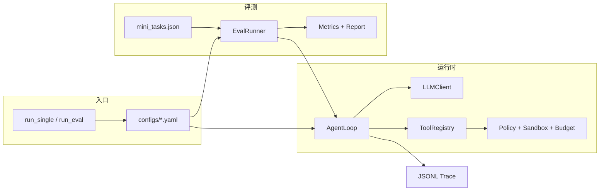

# Coding Harness 项目说明

> 面向简历、面试与自查：这份文档说明**项目具体做了什么**、**有哪些特点与亮点**。  
> 安装与命令见 [README.zh-CN.md](../README.zh-CN.md)；读代码路线见 [LEARNING.zh-CN.md](LEARNING.zh-CN.md)。

---

## 1. 一句话

在**模型不可信**的前提下，用 **Harness（运行时 + 策略 + 预算）** 约束 Coding Agent 的工具调用，并用 **同一套评测脚本** 对比「策略放宽 vs 收紧」后通过率、步数、失败类型等指标如何变化。

**不是**：一个聊天 Demo、也不是完整的多 Agent 协作平台。  
**是**：可复现的 **单 Agent 工程化运行时 + 内置 Benchmark 与报告**。

---

## 2. 具体做了什么

### 2.1 Agent 运行时（`src/runtime` + `src/llm` + `src/tools`）

实现标准的 **plan → act → observe** 循环（`AgentLoop`）：

1. 将用户任务与 system prompt、工具 schema 发给 **OpenAI 兼容** LLM（`LLMClient` → `POST .../chat/completions`）。
2. 若模型返回 **无 `tool_calls`** → 视为最终自然语言答案，任务结束。
3. 若有 **`tool_calls`** → 经注册表查找工具，在 **workspace 沙箱** 内执行，把每条结果写成 `role: tool` 消息拼回对话，进入下一轮。
4. 终止条件：最终答案、步数/总超时/单步超时耗尽、或 LLM 不可恢复错误。

支持的文件/命令类工具包括：`read_file`、`write_file`、`list_dir`、`run_command`、`search_replace`；另实现 `edit_file`、`read_events`（见配置是否启用）。

### 2.2 策略与安全（`src/policy`）

在工具真正执行前/执行中施加约束：

| 机制 | 作用 |
|------|------|
| **路径沙箱**（`Sandbox`） | 禁止绝对路径、`..` 穿越；所有读写限定在任务 workspace |
| **命令策略**（`CommandPolicy`） | 黑名单优先；`baseline` 宽松放行；`hardened` 仅允许白名单前缀 |
| **文件大小限制** | `file_size_limit_bytes` 限制读/写体量 |
| **输出截断** | 命令输出、`read_file` 行数上限，防止 context 被撑爆 |
| **预算**（`Budget`） | `max_steps`、总墙钟超时、单步超时（含上一轮 LLM + 工具时间） |

策略拒绝时：**不抛异常终止整轮**，而是返回失败的 `ToolResult` 写回对话，模型可改策略重试；同时统计 `policy_blocks` 与 `tool_failures`。

### 2.3 评测 Harness（`src/eval` + `datasets/`）

- **数据集**：`datasets/mini_tasks.json`，**36** 条编码小任务（含 `difficulty`、`tags`）。
- **批量运行**：`EvalRunner` 为每条任务准备 `initial_files`、临时 workspace、调用 `agent.run`。
- **四种自动判定**（`expected.type`）：

  | 类型 | 含义 |
  |------|------|
  | `file_contains` | 文件内容包含关键词 |
  | `command_output` | 在 workspace 执行命令，输出含关键词 |
  | `keywords_in_answer` | 最终答案含关键词 |
  | `file_exists` | 文件存在（可选最小字节数） |

- **通过定义**：`passed = agent.success ∧ expected_check`（跑完 ≠ 做对）。
- **报告**：`reports/` 下 Markdown + CSV；支持 `--compare` 对比 **baseline vs hardened**。

### 2.4 可观测性（`src/tracing`）

| 产物 | 内容 |
|------|------|
| **Step Trace**（`TraceLogger`） | 每轮 LLM/工具的 JSONL：phase、tool_calls、结果摘要、耗时 |
| **Lifecycle EventBus**（可选） | `run_start` / `llm_complete` / `tools_complete` / `run_end` 等；`debug.yaml` 开启 |
| **示例轨迹** | `docs/examples/demo_baseline_synthetic.jsonl`（Mock LLM，无需 API Key） |

### 2.5 配置与装配（`src/harness` + `src/config`）

- **YAML 配置**：`configs/baseline.yaml`、`hardened.yaml`、`debug.yaml`。
- **环境变量插值**：`${LLM_API_KEY}` 等。
- **Pydantic 校验**：错误字段启动即失败。
- **统一工厂**：`load_config` + `build_agent`，`run_single` / `run_eval` 共用，避免重复拼装。

### 2.6 扩展机制（已实现、可按配置开关）

- **Hook 管线**：`before_llm` / `after_tools`（默认无 Hook；可接 **Layer-1 micro-compact** 压缩旧 tool 消息）。
- **Prompt 外置**：`prompts/system_default.md`，由 `runtime.system_prompt_path` 指定。
- **重试**：`RetryPolicy` 对 LLM 超时等可配置重试。

---

## 3. 架构示意

---

## 4. 特点与亮点（面试可讲）

### 4.1 工程化 Harness，而非「脚本调 API」

- 模块边界清晰：`runtime` / `policy` / `tools` / `eval` / `tracing` / `harness`。
- **模型负责决策，代码负责约束与度量**——与 Claude Code 类产品的 Harness 心智模型一致。

### 4.2 可复现的策略对比实验

- **同一数据集、同一 LLM**，只换 YAML（baseline ↔ hardened），即可对比：
  - 成功率（`success ∧ expected_check`）
  - 平均步数、耗时、token
  - **精确** `tool_failure_rate`（分母为真实 `total_tool_invocations`）
  - `policy_block` 汇总次数  
- 适合写进简历：**「量化收紧策略的代价」**。

### 4.3 评测与运行分离、语义清晰

- `success`：Agent 是否正常给出终局答案（无工具结束）。
- `expected_check`：任务是否通过数据集裁判。
- 避免「跑完了就算对」的误导；报告与 CSV 含 **`trace_file`** 便于回溯失败任务。

### 4.4 安全与资源多层防护

- 路径沙箱 + 命令黑白名单 + 步数/超时 + 文件大小与输出截断。
- 策略失败以 **tool 错误消息** 反馈给模型，符合真实 Agent 产品行为。

### 4.5 可观测、可调试

- JSONL 逐步轨迹；debug 配置下 lifecycle 事件 + `read_events` 工具。
- 71 个测试，含 **Mock LLM 集成测**，CI 可不依赖 API Key。

### 4.6 可扩展点（已留接口）

- 新工具：实现 `Tool` + 注册到 `ToolRegistry` + YAML `enabled`。
- 新判定：`EvalRunner` 增加 `expected.type` 分支 + 数据集条目 + 单测。
- 新策略档：复制 YAML 调参（计划中的 **strict** 第三档即属此类）。
- Hook / prompt 文件 / micro-compact：不改主循环即可做实验。

---

## 5. 三套配置各解决什么问题

| 配置 | 定位 | 典型用途 |
|------|------|----------|
| **baseline** | 能力上限参考：命令宽松、步数较多 | 「模型在少约束下能完成多少题」 |
| **hardened** | 生产向收紧：命令白名单、更小文件限制、更短超时 | 「收紧后通过率/失败类型如何变」 |
| **debug** | 开发调试：lifecycle 事件 + `read_events` | 排查循环内部，**不用于**正式 A/B 对比 |

---

## 6. 技术栈与规模（约）

| 项 | 说明 |
|----|------|
| 语言 | Python 3.11+ |
| LLM 接入 | OpenAI 兼容 HTTP（如 DeepSeek） |
| 配置 | YAML + Pydantic + dotenv |
| 测试 | pytest-asyncio，**71** tests |
| 数据集 | 36 tasks，4 种 expected 类型 |
| 版本 | 0.1.0（`pyproject.toml`） |

---

## 7. 刻意不做 / 已知边界（诚实表述）

| 未做 | 原因简述 |
|------|----------|
| **Multi-Agent 团队**（信箱、多线程、抢任务） | 破坏单 Agent 评测可比性；复杂度高，与「策略 A/B」主线无关 |
| **Docker / 网络隔离** | 当前为路径 + 命令级沙箱；足够支撑教学/实习级实验 |
| **LLM 流式输出** | v0.1 仅非流式 `chat()` |
| **Layer-2 对话总结压缩** | eval 默认关闭，避免 run 间不可比 |
| **全量 eval 无 API 的 CI** | 有 Mock 集成测；完整 36 题需 API Key |

与 [learn-claude-code-main](https://github.com) 类教学仓库的关系：**借鉴** Hook、micro-compact、EventBus 等**机制**；**保留**本项目的 policy/eval/指标体系，不照搬 Anthropic API 与多 Agent 课程代码。

---

## 8. 和「Agent 研发 / 抖音类」岗位的表述对齐（可选）

无需把项目改成 Multi-Agent，可这样对齐 JD：

| JD 常见表述 | 本项目对应 |
|-------------|------------|
| 构建可靠 Agent、规划与执行 | `AgentLoop` + Budget + 工具链 |
| 任务分解 | 可由 prompt / 模型在单 loop 内完成；runtime 可扩展 subagent 工具 |
| Multi-Agent 系统 | **设计层面**：多 Worker = 多个 `AgentLoop` + 协调层；**实现**：单 Agent 深度工程化 |
| 工程研发各阶段 | Eval、trace、配置化、测试 |
| Prompt 工程 | 外置 `prompts/system_default.md`，可做 A/B |

---

## 9. 后续可选增强（未做或计划中）

| 项 | 价值 |
|----|------|
| **strict.yaml** 第三档配置 | 策略梯度对比（baseline / hardened / strict） |
| 按 **difficulty** 分桶报告 | 评测维度设计 |
| 1 条**真实**脱敏 API trace | 面试展示 |
| `git` + CI | 交付规范 |

这些是当时列出的候选，没有全部实施；以仓库实际代码和 [docs/INDEX.md](INDEX.md) 为准。

---

## 10. 相关文档索引

| 文档 | 用途 |
|------|------|
| [README.zh-CN.md](../README.zh-CN.md) | 安装、命令、配置表 |
| [LEARNING.zh-CN.md](LEARNING.zh-CN.md) | 读代码三遍法、自测题 |
| [INDEX.md](INDEX.md) | 全部文档的分类和阅读顺序 |
| [PROJECT-HISTORY.zh-CN.md](PROJECT-HISTORY.zh-CN.md) | 逐轮记录：做了什么、哪里错了、怎么修的 |

---

## 11. 简历用短描述（可直接粘贴）

**Coding Agent Harness** — Python 单 Agent 运行时与评测框架。实现 plan-act-observe 循环、路径沙箱与命令白名单、步数/超时预算；内置 36 题 mini benchmark 与四种任务判定，支持 baseline/hardened 配置对比与 JSONL 轨迹；71 个单测含 Mock LLM 集成测试。用于量化「策略收紧」对通过率、工具失败率与 policy 拦截的影响。

---

*文档随仓库演进更新；若代码与本文冲突，以 `src/` 与 `tests/` 为准。*
