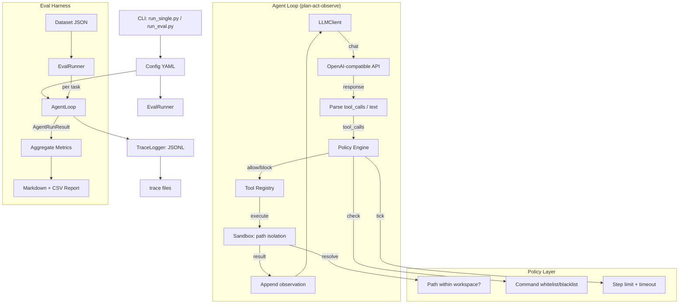

> This directory is part of a monorepo. It was the standalone `coding-harness` repository; its history is kept.
> For the overview, the results and where to start reading, go back to the [root README](../README.md).

# Coding Harness

**中文文档**：[README.zh-CN.md](README.zh-CN.md) · [学习指南（阅读顺序与自测题）](docs/LEARNING.zh-CN.md)

A controllable Coding Agent Runtime with integrated Eval Harness — built for reproducible, measurable, regressable agent evaluation.

**A5-main:** on 56 SWE-bench Verified tasks, B0 (no memory, 68.5% solved) was compared with B2 (injected validated_fix cards mined by rule from earlier tasks in the same repository), 3 runs each; no effect larger than 13.1 percentage points was detected. See the [project history](docs/PROJECT-HISTORY.zh-CN.md), [A5-main design](docs/sprint/A5-MAIN-DESIGN.zh-CN.md), [run inventory](docs/sprint/A5-MAIN-INVENTORY.md), and in the agent repository the [results report](../agent/docs/sprint/A5-MAIN-RESULTS.zh-CN.md) and [final report](../agent/docs/A5-FINAL-REPORT.zh-CN.md).

Current controlled profile: [H3 Docker](docs/upgrade/H3-IMPLEMENTATION.zh-CN.md), [H4 context/plugin interface](docs/upgrade/H4-IMPLEMENTATION.zh-CN.md), and [real DeepSeek Flash integration](docs/upgrade/H5-DEEPSEEK.zh-CN.md). The [R1 closeout](docs/upgrade/R1-CLOSEOUT.zh-CN.md) records the verified scope and evidence. The DeepSeek demo uses a pinned public module slice and an independent grader; it requires Docker/Linux and explicit paid-call opt-in. Legacy host examples below are trusted-local only, not filesystem isolation.

After R1: [R2-lite true summary](docs/upgrade/R2-LITE-TRUE-SUMMARY.zh-CN.md) adds an explicit LLM summary provider with shared budgets and recovery deduplication; fixture remains the default. The [real-provider pilot](docs/upgrade/evidence/R2-real/README.md) completed one summary smoke, 36 fixed-history comparisons, and eight Docker repair runs. Summaries relieved some overflows, but factual adoption was inconsistent; improved repair success was not demonstrated.

A [wrapper-only follow-up and offline window preflight](docs/upgrade/evidence/R2-real/wrapper-01/README.md) reused nine fixed summaries: the historical-evidence wording achieved 26/27 fully correct answers versus 7/27 with the original wrapper. Runtime defaults remain unchanged; this mechanism result does not establish improved repair success.

## Architecture



## Quick Start

### 1. Install

```bash
pip install -e ".[dev]"
```

### 2. Configure

```bash
cp .env.example .env
# Edit .env with your API key and model
```

Or set environment variables directly (DeepSeek OpenAI 兼容，`base_url` 须含 `/v1`)：

```bash
export LLM_API_KEY="your-deepseek-api-key"
export LLM_BASE_URL=https://api.deepseek.com/v1
export LLM_MODEL=deepseek-v4-pro
```

PowerShell：

```powershell
$env:LLM_API_KEY = "your-deepseek-api-key"
$env:LLM_BASE_URL = "https://api.deepseek.com/v1"
$env:LLM_MODEL = "deepseek-v4-pro"
```

### 3. Run a Single Task

```bash
python scripts/run_single.py "Create a file hello.py that prints 'Hello, World!'"
```

With a specific config:

```bash
python scripts/run_single.py --config configs/hardened.yaml "List all files"

# Debug with lifecycle events:
python scripts/run_single.py --config configs/debug.yaml "List all files"
```

### 4. Run the Eval Suite

```bash
# Run with baseline config only
python scripts/run_eval.py --dataset datasets/mini_tasks.json --configs baseline

# Compare baseline vs hardened
python scripts/run_eval.py --dataset datasets/mini_tasks.json --compare
```

### 5. Run Tests

```bash
pytest tests/ -v
```

## Configuration

Three reference configs are provided:

| Config | Command Policy | Sandbox | Use Case |
|--------|---------------|---------|----------|
| `baseline.yaml` | allow_all (except dangerous patterns) | Path isolation + output truncation | Measure raw model capability |
| `hardened.yaml` | Strict whitelist | Path isolation + file size limits + output truncation | Measure safe-agent performance |
| `debug.yaml` | allow_all | Path isolation + lifecycle events | Local troubleshooting with `read_events` tool |

### Environment Variable Interpolation

Config files support `${VAR:default}` syntax:

```yaml
llm:
  api_key: "${LLM_API_KEY}"
  model: "${LLM_MODEL:deepseek-v4-pro}"
```

### System Prompt

The system prompt lives in `prompts/system_default.md`, configured via `runtime.system_prompt_path`. Edit the file to experiment with prompt behavior without touching Python code.

### Demo Trace

`docs/examples/demo_baseline_synthetic.jsonl` is a synthetic trace (Mock LLM, no API key needed) showing a full think→act→observe cycle: `read_file` → `write_file` → final answer.

## Dataset Format

Tasks are defined in JSON with a stable schema:

```json
{
  "id": "task_unique_id",
  "description": "Natural language task description",
  "initial_files": {
    "file.txt": "content",
    "subdir/": {}
  },
  "expected": {
    "type": "file_contains | command_output | keywords_in_answer | file_exists",
    "path": "relative/path",
    "keywords": ["must", "contain", "these"],
    "min_size_bytes": 10  // optional, for file_exists only
  },
  "difficulty": "easy | medium | hard",
  "tags": ["file-creation", "python"]
}
```

The `mini_tasks.json` dataset contains 36 tasks covering:
- File creation (Python, HTML, CSS, JSON, YAML, SQL, Markdown, CSV, etc.)
- File modification (typo fixes, variable renames, content updates)
- Multi-step operations (read-then-write, transform)
- Code generation (React components, TypeScript interfaces, Python modules)

## Interpreting the Report

The eval generates two files in `reports/`:

### Markdown Report (`report_*.md`)
- **Summary table**: per-config success rate, avg steps, avg time, tool failure rate
- **Comparison table**: delta between two configs (shown when running `--compare`)
- **Failure breakdown**: categorized by timeout / tool_error / policy_block / model_parse_error / step_limit
- **Per-task results**: each task with pass/fail, steps, timing

### CSV Report (`report_*.csv`)
- One row per task per config
- Columns: config, task_id, success, expected_check, steps, elapsed_ms, tokens, tool_failures, policy_blocks, failure_reason, trace_file

## Project Structure

```
coding-harness/
├── pyproject.toml              # Dependencies & build
├── .env.example                # Environment template
├── configs/
│   ├── baseline.yaml           # Permissive config
│   ├── hardened.yaml           # Strict config
│   └── debug.yaml              # Debug config (lifecycle events + read_events)
├── prompts/
│   └── system_default.md       # System prompt (editable without touching Python)
├── docs/
│   └── examples/
│       └── demo_baseline_synthetic.jsonl  # Synthetic agent trace
├── datasets/
│   └── mini_tasks.json         # 36 evaluation tasks
├── scripts/
│   ├── run_single.py           # Single task CLI
│   └── run_eval.py             # Batch eval CLI
├── src/
│   ├── config/
│   │   └── schema.py           # Pydantic config validation
│   ├── harness/
│   │   └── factory.py          # Unified load_config + build_agent
│   ├── llm/client.py           # LLMClient (OpenAI-compatible)
│   ├── tools/                  # Tool implementations
│   │   ├── files.py            # read_file, write_file, list_dir
│   │   ├── command.py          # run_command (with output truncation)
│   │   ├── edit.py             # edit_file (single-occurrence replace)
│   │   ├── patch.py            # search_replace (unique-match replace)
│   │   └── events.py           # read_events (debug, not in hardened)
│   ├── policy/                 # Safety & budget
│   │   ├── sandbox.py          # Path isolation
│   │   ├── rules.py            # Command whitelist/blacklist
│   │   ├── limits.py           # File size enforcement
│   │   └── budget.py           # Step + time limits
│   ├── runtime/                # Agent loop + hooks
│   │   ├── loop.py             # plan-act-observe cycle
│   │   ├── state.py            # State machine
│   │   ├── hooks.py            # Pluggable before_llm / after_tools hooks
│   │   ├── compact.py          # Layer-1 micro-compact
│   │   └── retry.py            # Retry with backoff
│   ├── tracing/                # Observability
│   │   ├── models.py           # Trace data types
│   │   ├── logger.py           # JSONL step logger
│   │   └── events.py           # Lifecycle EventBus
│   └── eval/                   # Evaluation harness
│       ├── runner.py           # Batch runner (with per-task traces)
│       ├── metrics.py          # Metric aggregation
│       └── report.py           # Markdown + CSV generator
└── tests/                      # 71 unit + integration tests
    ├── fixtures/
    │   └── mock_llm.py         # Mock LLM client for CI
    ├── test_sandbox.py         # Path isolation
    ├── test_policy.py          # Command rules + budget
    ├── test_tools.py           # File, search_replace, edit_file, truncation
    ├── test_compact.py         # Micro-compact + EventBus
    ├── test_timeout.py         # Retry & timeout
    ├── test_runner.py          # Metrics & reports
    └── test_agent_loop.py      # AgentLoop integration (no API key needed)
```

## Design Decisions

| Decision | Rationale |
|----------|-----------|
| Async throughout | Enables concurrent eval runs; `httpx` + `asyncio` are mature |
| Path guards + controlled Docker profile | Path guards reject file-tool traversal; arbitrary host commands require trusted-local use. Use `docker_linux` for the verified container boundary. |
| Config-driven tools | Same agent code, different safety profiles via YAML |
| JSONL tracing | Append-only, human-readable with `jq`, easy to query |
| `expected.type` in dataset | Four judge strategies (file_contains, command_output, keywords_in_answer, file_exists) cover most coding tasks without custom test harnesses |
| System prompt in file | Prompt text lives in `prompts/` directory, editable without touching Python — enables prompt experimentation |

## Dependencies

- `httpx` — async HTTP for LLM API calls
- `pyyaml` — config file parsing
- `pydantic` — config schema validation (catches YAML typos at startup)
- `pytest` + `pytest-asyncio` — testing

Docker is optional for legacy trusted-local examples and required for the controlled `docker_linux` profile. No vendor SDKs — `LLMClient` wraps the OpenAI-compatible `/chat/completions` endpoint.
