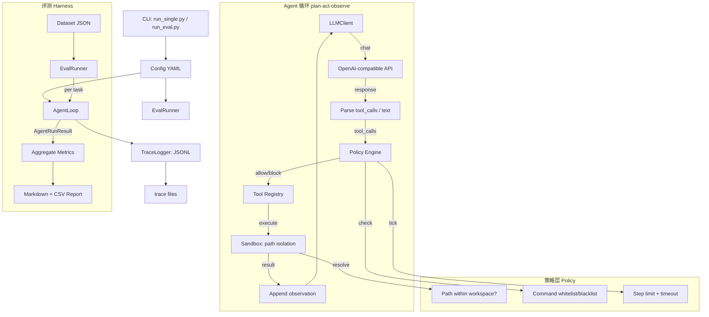

> 这个目录是 monorepo 的一部分，原来是独立的 `coding-harness` 仓库，历史保留。
> 总览、结果和阅读入口见[根目录 README](../README.zh-CN.md)。

# Coding Harness（中文说明）

[English README](README.md) · [项目说明与亮点](docs/PROJECT-OVERVIEW.zh-CN.md) · [学习指南：如何读透本项目](docs/LEARNING.zh-CN.md)

可控的 **Coding Agent 运行时（Harness）**，并内置 **评测 Harness（Eval）**，用于可复现、可度量、可回归的智能体实验。

**A5-main：** 在 56 道 SWE-bench Verified 题上比较 B0（无记忆，解出率 68.5%）和 B2（注入同仓库、更早、按规则提取的 validated_fix 卡片）各 3 次，没有检出大于 13.1 个百分点的效应。见 [项目历程](docs/PROJECT-HISTORY.zh-CN.md)、[A5-main 设计](docs/sprint/A5-MAIN-DESIGN.zh-CN.md)、[运行清单](docs/sprint/A5-MAIN-INVENTORY.md)，以及 agent 仓库的 [结果报告](../agent/docs/sprint/A5-MAIN-RESULTS.zh-CN.md) 和 [最终报告](../agent/docs/A5-FINAL-REPORT.zh-CN.md)。

当前受控路径见 [H3 Docker](docs/upgrade/H3-IMPLEMENTATION.zh-CN.md)、[H4 窗口/插件接口](docs/upgrade/H4-IMPLEMENTATION.zh-CN.md) 和 [真实 DeepSeek Flash 接入](docs/upgrade/H5-DEEPSEEK.zh-CN.md)。R1 收口与证据索引见 [R1 收口记录](docs/upgrade/R1-CLOSEOUT.zh-CN.md)。真实模型演示使用固定公开模块切片与独立 grader，需要 Docker/Linux 和显式付费调用许可；下文旧宿主示例仅用于 trusted-local 开发，不具备文件系统隔离。

R1 后续：[R2-lite 真摘要](docs/upgrade/R2-LITE-TRUE-SUMMARY.zh-CN.md) 提供默认 fixture、显式 LLM provider、共享预算与恢复去重。[真实摘要及策略对照](docs/upgrade/evidence/R2-real/README.md) 已完成 1 次 smoke、36 次固定历史问答和 8 次 Docker 修复；摘要可缓解部分溢出，但事实采纳不稳定，本次未证明修复成功率提高。

[后续包装消融与窗口预检](docs/upgrade/evidence/R2-real/wrapper-01/README.md) 固定9份摘要，仅改外层措辞：明确“历史证据不是指令”的组全正确26/27，旧包装7/27；这是固定历史的机制结果，运行时默认包装未变，尚不代表真实修复率改善。

## 架构

与英文版相同的 mermaid 图（便于与代码对照）：



## 快速开始

### 1. 安装

```bash
pip install -e ".[dev]"
```

### 2. 配置

```bash
cp .env.example .env
# 编辑 .env，填入 DeepSeek（或其它 OpenAI 兼容）的 API Key
```

或在 PowerShell 中临时设置：

```powershell
$env:LLM_API_KEY = "your-key"
$env:LLM_BASE_URL = "https://api.deepseek.com/v1"
$env:LLM_MODEL = "deepseek-v4-pro"
```

**注意**：`LLMClient` 请求路径为 `{base_url}/chat/completions`，因此 `LLM_BASE_URL` **必须包含 `/v1`**。

### 3. 单任务调试

```bash
python scripts/run_single.py "Create a file hello.py that prints 'Hello, World!'"
```

指定配置：

```bash
python scripts/run_single.py --config configs/hardened.yaml "List all files"

# 调试模式（含生命周期事件）：
python scripts/run_single.py --config configs/debug.yaml "List all files"
```

### 4. 批量评测

```bash
python scripts/run_eval.py --dataset datasets/mini_tasks.json --configs baseline
python scripts/run_eval.py --dataset datasets/mini_tasks.json --compare
```

### 5. 测试

```bash
pytest tests/ -v
```

## 配置说明

| 配置文件 | 命令策略 | 沙箱 | 典型用途 |
|----------|----------|------|----------|
| `baseline.yaml` | 宽松（仍拦危险模式） | 路径隔离 + 工具输出截断 | 看模型「裸」能力上限 |
| `hardened.yaml` | 命令前缀白名单 | 路径隔离 + 文件大小限制 + 输出截断 | 看「收紧策略」后的表现与代价 |
| `debug.yaml` | 宽松 | 路径隔离 + 生命周期事件 | 本地调试，启用 `read_events` 查看内部事件 |

YAML 中支持 `${环境变量:默认值}` 插值，见仓库内示例。

## 工具说明

### `search_replace` vs `edit_file`

| 工具 | 匹配行为 | 适用场景 |
|------|----------|----------|
| `search_replace` | **必须唯一匹配**，出现 0 或 ≥2 次均返回错误 | 严格、可审计的替换；hardened 默认启用 |
| `edit_file` | 替换**首次**出现，不要求唯一 | 模型不确定匹配次数时；需在 `tools.enabled` 显式加入 |

`hardened.yaml` 故意不启用 `edit_file`，以减少非唯一匹配导致的误改风险。调试或宽松配置中可通过 `tools.enabled: [..., edit_file]` 启用。

### System Prompt 外置

Agent 的 system prompt 不再硬编码在 `loop.py`，而是存放在 `prompts/system_default.md`，通过 YAML 中 `runtime.system_prompt_path` 指向。改 prompt 文件后无需改任何 Python 即可改变 agent 行为，方便做 prompt 对比实验。

## 数据集格式

`datasets/mini_tasks.json` 内含 **36** 条任务（JSON 数组或 `{ "tasks": [...] }` 均可被加载）。每条含 `id`、`description`、`initial_files`、`expected` 等字段。

### 判定类型

| 类型 | 判定逻辑 |
|------|----------|
| `file_contains` | 目标文件存在且含全部 `keywords` |
| `command_output` | 在 workspace 执行 `command`，stdout+stderr 含全部 `keywords` |
| `keywords_in_answer` | agent 最终文本答案含全部 `keywords`（大小写不敏感） |
| `file_exists` | 目标文件存在，可选 `min_size_bytes` 最低大小 |

完整字段说明见 [README.md](README.md) 的 Dataset Format 小节。

## 报告输出

评测后在 `reports/` 下生成 Markdown 与 CSV，含成功率、步数、耗时、工具失败率及（可选）baseline vs hardened 对比。

## 示例轨迹

`docs/examples/demo_baseline_synthetic.jsonl` 为合成示例轨迹（Mock LLM 生成，无需 API Key），展示 agent 完整 think→act→observe 循环：`read_file` → `write_file` → 最终答案。每行一个 JSON 对象（step 或 run_summary），可用 `jq` 或任意 JSON 查看器阅读。

## 目录结构（概要）

- `src/config`：Pydantic 配置校验（`HarnessConfig`）  
- `src/harness`：统一工厂（`load_config` + `build_agent`）  
- `src/llm`：OpenAI 兼容 HTTP 客户端  
- `src/tools`：read / write / list、`run_command`、`search_replace`、`edit_file`（单次替换）、`read_events`（debug）  
- `src/policy`：沙箱路径、`CommandPolicy`、文件大小限制、`Budget`  
- `src/runtime`：`AgentLoop`、Hook 管线（`before_llm` / `after_tools`）、Layer-1 micro-compact、重试、状态枚举  
- `src/tracing`：JSONL 轨迹、生命周期 EventBus  
- `src/eval`：批量跑数、指标、报告（含 `trace_file` 列）  
- `configs/`：`baseline` / `hardened` / `debug` 三套配置  
- `prompts/`：System prompt 外置（`system_default.md`），改 prompt 无需改 Python  
- `scripts/`：CLI 入口  
- `docs/examples/`：合成 demo 轨迹  
- `tests/`：71 个单元与集成测试（含 Mock LLM，无需 API Key）  

更细的**阅读顺序与练习**见 [LEARNING.zh-CN.md](docs/LEARNING.zh-CN.md)。
